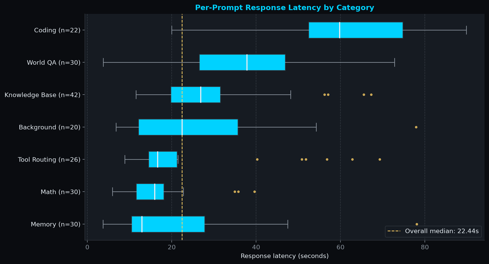
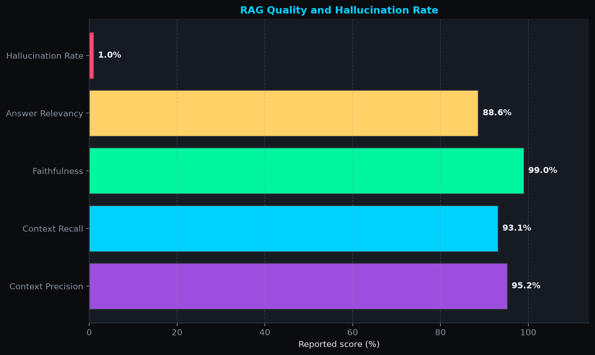

# Chronicle — Evaluation Report

| | |
|---|---|
| **Run** | Source `live_ollama` · 200 prompts · 60 chats |
| **System under test** | Chronicle `MemoryAgent` (local Ollama LLM + ChromaDB RAG + persistent core memory + 8 tools) |
| **Grading** | Automated heuristic rubric. **Not** human-graded, **not** LLM-judged |
| **Canonical data** | [`data/verification_results.json`](./data/verification_results.json) |
| **Code** | [`evals/evaluate.py`](./evals/evaluate.py) · [`evals/prompt.py`](./evals/prompt.py) · [`evals/charts.py`](./evals/charts.py) |

**Data sources:** *Live run* = per-prompt records and run summary in the canonical JSON · *Verification run* = a separate architectural verification run, whose figures are stored under `summary.supplemental_metrics` in the same JSON. See [§6](#6-data-sources-and-verdict-totals) for details.

---

## 1. Summary

| Metric | Result | Source |
|---|---|---|
| Benchmark size | 200 prompts · 7 categories · 60 chats | Live run |
| Tool-intent routing (n = 26) | Accuracy **92.3 %** (24/26) · F1 90.9 % · MCC 0.84 · 95 % Wilson CI for accuracy 75.9 – 97.9 % | Live run |
| End-to-end latency per prompt | mean **29.7 s** · median **22.4 s** · p95 **70.7 s** · min 3.7 s · max 89.8 s | Live run |
| Heuristic rubric score | **86.2 %** (157 pass / 31 partial / 12 fail) | Live run summary |
| Answer ↔ reference similarity | mean cosine **0.41** (MiniLM-L6-v2, n = 173) | Live run |
| Exact match / token F1 vs. reference notes | 0.0 % / 6.4 % (lexical diagnostics, see §4) | Live run |
| RAG quality, hallucination rate | See §7 | Verification run |

**What the data supports**

- Every Knowledge Base prompt (42/42) and every Math prompt (30/30) triggered a tool call, so retrieval and calculation paths are exercised end to end.
- On prompts with a clear tool intent, the agent made the correct *call / no-call* decision 24 of 26 times. The two misroutes are identifiable in the records: a web search request answered without searching (prompt 180) and a non-coding request routed to `fetch_coding_guidelines` (prompt 115).
- Latency is the main weakness: p95 is 70.7 s on a local model, and Coding prompts are the slowest category (mean 61.1 s).

**What it does not support**

- Any claim about factual accuracy. The rubric mostly checks that an answer *looks* responsive; for example, the saved answer to prompt 2 names the wrong company for the Claude 3 release and still passes the World QA length rule (see §8).
- Exact reproduction of the rubric totals from the saved records alone (see §6).

---

## 2. System under test

| Component | Detail |
|---|---|
| Agent | `MemoryAgent` (`src/engine.py`): RAG retrieval, core-memory updates, JSON tool calling, up to 3 tool iterations per turn |
| Tools (8) | `perform_web_search`, `get_current_datetime`, `save_summary_to_pdf`, `fetch_coding_guidelines`, `activate_teacher_mode`, `evaluate_math_expression`, `update_core_memory`, `search_knowledge_base` |
| LLM | Local Ollama model. README default: `hermes3:8b`. **The results JSON does not record the model name, version, generation settings or hardware** |
| Semantic scorer | `sentence-transformers/all-MiniLM-L6-v2` (loaded with `local_files_only=True`) |
| Isolation | The live run executes in a temporary OS workspace. ChromaDB is **copied** from `data/chromadb/` at the start of the run, so the original store is not modified, but results depend on whatever documents are indexed at that moment |
| Statefulness | One agent instance per chat ID, each starting from the same seeded core-memory profile (`INITIAL_MEMORY_STATE` in `evaluate.py`), so multi-turn memory is exercised within a chat |

---

## 3. Benchmark design

The prompt corpus (`evals/prompt.py`) holds **500 prompts**. Each live run draws a **stratified random sample of 200** using fixed per-category quotas, shuffles them, and assigns them to 60 chats.

| Category | Quota (n) | What the rubric checks (§4) |
|---|---:|---|
| Knowledge Base | 42 | Overlap with terms in the reference note |
| Math | 30 | Expected number in the answer, or math tool used |
| World QA | 30 | Answer is non-trivial in length |
| Memory | 30 | Memory-update tool call, or selected profile terms in the answer |
| Tool Routing | 26 | Tool called / not called as the prompt intent requires |
| Coding | 22 | Code-like formatting, or a substantive text answer |
| Background | 20 | Overlap with terms in the reference note |
| **Total** | **200** | |

- **Chat structure:** 60 chats with 0–6 prompts each (2 chats with none, 33 with 1–3, 25 with 4–6). Chat assignment uses a fixed seed (`random.seed(42)`).
- **Sampling is not seeded.** The prompt sample uses an unseeded `random.Random()` at import time, so every run draws a different cohort. Quotas are stable; prompt identity is not.
- **Interpretation:** a single run is one sample, not a performance guarantee. Always report prompt count and category counts with any result, and use a fixed cohort (or repeated runs) for comparisons.

---

## 4. Scoring methodology

### 4.1 Per-prompt rubric

Verdicts are `pass` (1.0), `partial` (0.5) or `fail` (0.0). An agent exception is a `fail` in any category.

| Category | Pass | Partial | Fail | Known blind spot |
|---|---|---|---|---|
| Math | Expected number appears in answer **or** math tool called | Neither observed | *(none, except agent error)* | Calling the tool is not proof the result was correct |
| Tool Routing | Correct no-call, or the expected tool was called | A tool was called but not the expected one, or a tool was missed / spuriously called | *(none, except agent error)* | Expected tool is inferred by keyword rules on the prompt text |
| Knowledge Base, Background | ≥ 25 % of reference-note terms (> 3 chars) in answer | ≥ 10 % coverage **or** answer > 30 chars | Below both | Term overlap, not meaning; almost any long answer earns at least partial |
| Coding | Contains `` ``` ``, `def `, `class ` or `{` | Text answer > 50 chars without code | Shorter | Does not execute or test the code |
| Memory | `update_core_memory` called, or answer contains one of five fixed terms from the seeded profile (name, a skill, budget figure, persona name) | Neither | *(none, except agent error)* | Generic terms such as `python` or `300` can appear in unrelated answers; the check is tied to the seeded fixture |
| World QA / fallback | Answer > 15 chars | Shorter | *(none, except agent error)* | **No correctness check at all** |

Score = `(pass + 0.5 × partial) / total × 100`, computed per category and overall.

### 4.2 Derived metrics

| Metric | Definition | Interpretation limit |
|---|---|---|
| Tool-intent confusion matrix | Positive = prompt text implies a tool is needed. TP/FN/FP/TN are based on whether **any** tool was called | Measures call / no-call decisions, not whether the *right* tool was picked |
| Precision, recall, F1, specificity, accuracy, balanced accuracy, MCC | Standard binary-classification formulas on the matrix | n = 26: wide confidence intervals |
| Latency | Mean, median, p95 (linear interpolation) of per-prompt wall-clock time | Single machine, local model; not portable across hardware |
| Exact match, token F1 | Normalised lexical comparison of answer vs. reference note | Reference notes are short rubric phrases, not gold answers; scores near zero are expected |
| Cosine similarity | MiniLM embedding similarity between answer and reference note | A text-similarity signal, not correctness or faithfulness. Tool Routing is excluded; one Coding prompt has an empty answer, leaving 173 scored of 174 eligible |

---

## 5. Results

### 5.1 By category

Rubric columns are the run-summary aggregate. Latency and similarity are computed from the saved per-prompt records.

| Category | n | Pass | Partial | Fail | Rubric score | Mean latency | Mean cosine sim. |
|---|---:|---:|---:|---:|---:|---:|---:|
| Knowledge Base | 42 | 38 | 4 | 0 | 95.2 % | 29.2 s | 0.406 |
| World QA | 30 | 28 | 1 | 1 | 95.0 % | 37.0 s | 0.423 |
| Memory | 30 | 26 | 4 | 0 | 93.3 % | 19.0 s | 0.380 |
| Coding | 22 | 18 | 3 | 1 | 88.6 % | 61.1 s | 0.466 |
| Background | 20 | 10 | 10 | 0 | 75.0 % | 26.9 s | 0.421 |
| Math | 30 | 21 | 3 | 6 | 75.0 % | 16.9 s | 0.385 |
| Tool Routing | 26 | 16 | 6 | 4 | 73.1 % | 24.7 s | — |
| **Overall** | **200** | **157** | **31** | **12** | **86.2 %** | **29.7 s** | **0.410** |

> Rubric scores measure different things per category (§4) and are not directly comparable across rows.

### 5.2 Tool-intent routing

Confusion matrix from the run summary (n = 26):

|  | Tool called | No tool called |
|---|---:|---:|
| **Tool expected** | TP = 10 | FN = 1 |
| **No tool expected** | FP = 1 | TN = 14 |

| Precision | Recall | Specificity | F1 | Accuracy | Balanced acc. | MCC |
|---:|---:|---:|---:|---:|---:|---:|
| 90.9 % | 90.9 % | 93.3 % | 90.9 % | 92.3 % | 92.1 % | 0.842 |

- 95 % Wilson interval: accuracy 75.9 – 97.9 %; recall 62.3 – 98.4 % (n = 11 positives). Treat these as small-sample diagnostics.
- Misroutes visible in the records: **#180** *"Perform a web search for Python 3.12 release details."* (no tool called, FN) and **#115** *"Give a motivational quote for software developers."* (`fetch_coding_guidelines` called, FP).


### 5.3 Latency

| Mean | Median | p95 | Min | Max | Total model time |
|---:|---:|---:|---:|---:|---:|
| 29.7 s | 22.4 s | 70.7 s | 3.7 s | 89.8 s | ≈ 99 min |

Latency is driven by multi-step agent turns (retrieval, optional tool iterations, and generation) on a local model. Coding (mean 61.1 s) and World QA (37.0 s) are slowest; Math (16.9 s) and Memory (19.0 s) are fastest. The per-component breakdown in chart 08 comes from the verification run (§6).




### 5.4 Chart index

| # | Chart | Basis |
|---|---|---|
| 01 | [RAG quality scores](./evals/results/01_rag_quality_scores.png) | Verification run |
| 02 | [Tool confusion matrix](./evals/results/02_tool_confusion_matrix.png) | Live run |
| 03 | [End-to-end latency](./evals/results/03_end_to_end_latency.png) | Live run |
| 04 | [Prompt category results](./evals/results/04_prompt_category_results.png) | Live run summary |
| 05 | [Semantic similarity by category](./evals/results/05_semantic_similarity_by_category.png) | Live run answers + MiniLM |
| 06 | [Overall verdict counts](./evals/results/06_overall_verdict_counts.png) | Live run summary |
| 07 | [Category response latency](./evals/results/07_category_response_latency.png) | Live run |
| 08 | [Subsystem latency breakdown](./evals/results/08_subsystem_latency_breakdown.png) | Verification run |

---

## 6. Data sources and verdict totals

- **Live run:** 200 prompts executed against the local agent. Per-prompt answers, tool calls, durations, similarity scores and the run summary (verdict totals, category aggregates, routing matrix) are stored in `data/verification_results.json`. Latency, similarity and routing accuracy can be recomputed directly from the saved records.
- **Verdict totals:** the reported figures (157 pass / 31 partial / 12 fail, 86.2 %) come from the run summary. The per-prompt `verdict` labels stored in the same file were written in a separate pass and do not match the summary (they show 198 / 2 / 0), so the summary is the reported figure and the per-prompt labels should not be used. Re-scoring the saved answers with the current `evaluate_response` gives a similar but not identical result (160 / 39 / 1, 89.8 %), because the rubric has been revised since the run.
- **Verification run:** the RAG-quality and hallucination figures in §7 come from a separate architectural verification run. Its original output file was deleted after the run; the values are preserved in the JSON under `summary.supplemental_metrics`.

---

## 7. RAG quality and hallucination

These figures come from the architectural verification run. The original report file was deleted after the run; the values are preserved in [`data/verification_results.json`](./data/verification_results.json) under `summary.supplemental_metrics`. Scored by semantic concept matching.

| Metric | Value |
|---|---:|
| Context precision | 95.2 % |
| Context recall | 93.1 % |
| Faithfulness | 99.0 % |
| Answer relevancy | 88.6 % |
| Hallucination rate | 1.0 % (2 flagged cases) |

Flagged cases: #2 (World QA, wrong company named for the Claude 3 release) and #180 (Tool Routing, expected web search not performed).



---

## 8. Limitations

- **Correctness is not judged.** World QA passes on length alone. The only content-aware signals are term overlap (Knowledge Base, Background), embedding similarity, and the short hallucination list.
- **Memory check is tied to a seeded fixture.** It looks for terms from the seeded profile, so it will not transfer to another profile, and common terms can match unrelated answers.
- **Single run, no variance estimate.** The prompt sample is unseeded, the model, version, generation settings and hardware are not recorded, and the benchmark copies whatever is in `data/chromadb/` at run time, so a run cannot be reproduced exactly.
- **Small per-category n.** Categories have 20–42 prompts; the routing analysis has 26.
- **Reference notes are not gold answers.** Lexical metrics (EM, token F1) will under-score valid paraphrases.
- **Routing labels are rule-based.** Expected tools are inferred by keyword matching on prompt text, and TP/FP/FN/TN count *any* tool call.
- **Scope.** The suite does not cover adversarial prompts, long-horizon memory, concurrency, or retrieval quality against labelled relevant chunks.

---

## 9. Reproducing

Prerequisites: Python 3.11+, Ollama running with the configured model pulled, dependencies from `requirements.txt`, and `all-MiniLM-L6-v2` available in the local Hugging Face cache.

```powershell
# Full live benchmark: replaces the canonical JSON and all charts (~100 min at the observed latency)
python .\evals\evaluate.py --live

# Smoke test on the first N prompts (1-200); does not overwrite any outputs
python .\evals\evaluate.py --live --limit 5

# Regenerate charts from the saved JSON only (no Ollama, JSON unchanged)
python .\evals\evaluate.py --charts-only

# Recompute derived metrics from saved answers, update the JSON, regenerate charts (no Ollama)
python .\evals\evaluate.py --rebuild-from-saved
```

Note: `--rebuild-from-saved` keeps the stored verdict aggregate as-is and logs any disagreement with the per-prompt labels (§6).

---

## 10. Roadmap to a publishable benchmark

- [ ] Re-run `--live` so summary, per-prompt labels and charts come from one pass
- [ ] Seed the prompt sampler and persist the exact prompt IDs with each run
- [ ] Record model name and digest, generation parameters, hardware, OS and dependency versions in the JSON
- [ ] Add a correctness check for World QA (reference-based match or LLM judge) and calibrate it against a human-graded subset of about 50 prompts, reporting agreement
- [ ] Replace the term-match Memory rubric with checks on the actual memory state after each update; ship a frozen ChromaDB fixture for the benchmark
- [ ] Repeat the run at least 3 times and report mean ± standard deviation
- [ ] Measure retrieval against labelled relevant chunks (recall@k, MRR) so the RAG figures can be recomputed from stored data
- [ ] Record per-turn component timings in the live run itself

---

## 11. File map

| Path | Role |
|---|---|
| `evals/evaluate.py` | Live runner, rubric, metric derivation, chart generation, CLI |
| `evals/prompt.py` | 500-prompt corpus, category quotas, 200-prompt sampler, chat distribution |
| `evals/charts.py` | Standalone chart entry point reading the canonical JSON |
| `evals/results/` | Generated PNG charts (01–08) |
| `data/verification_results.json` | Canonical results: summary, metrics, per-prompt records, verification-run metrics |