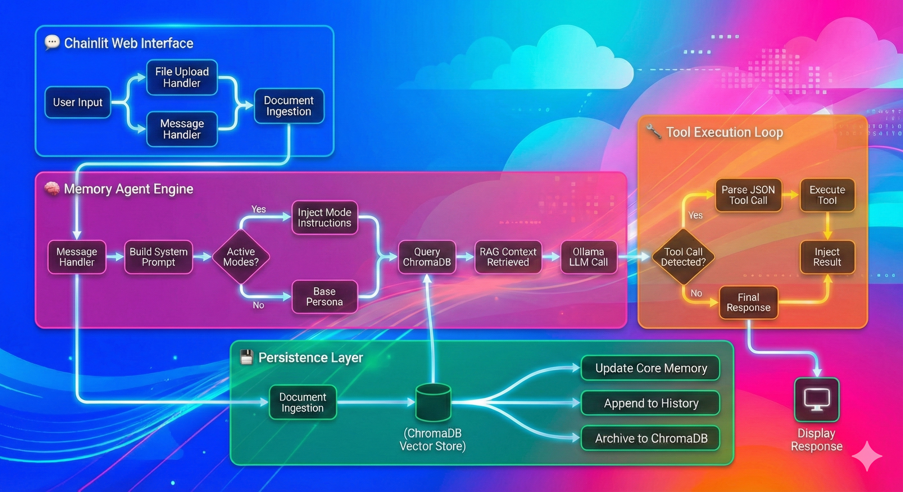

  <a href="EVALUATION.md"></a>
  
  
  
  
  
  
</p>

# 🧠 Chronicle — Infinite Memory LLM Agent

> **A lightweight, framework-free AI assistant with persistent memory, RAG capabilities, and a stunning cyberpunk UI.**

Chronicle is a fully local, privacy-first AI agent that remembers everything. Built from scratch using pure Python, it combines vector-based document retrieval (RAG), persistent core memory, dynamic tool execution, and a beautiful glassmorphism chat interface—all running on your own hardware via Ollama.

---

## 📋 Table of Contents

- [The Problem](#-the-problem)
- [The Solution](#-the-solution)
- [Key Features](#-key-features)
- [Technical Architecture](#-technical-architecture)
- [Architectural Verification & Evaluation](#-architectural-verification--evaluation)
- [Getting Started](#-getting-started)
- [Usage](#-usage)
- [Project Structure](#-project-structure)
- [Available Tools](#-available-tools)
- [Agent Modes](#-agent-modes)
- [Roadmap](#-roadmap)

---

## ❌ The Problem

Traditional LLM chatbots suffer from **amnesia**—every conversation starts from zero. They:

- Forget your name, preferences, and context between sessions
- Cannot access your personal documents or knowledge base
- Require expensive cloud APIs with privacy concerns
- Lack the ability to take actions (web search, file generation, calculations)

---

## ✅ The Solution

Chronicle solves this with a **three-tier memory architecture**:

| Memory Layer | Technology | Purpose |
|--------------|------------|---------|
| **Core Memory** | JSON file (`data/memory.json`) | Persistent user info, preferences, persona |
| **Conversation History** | JSONL + SQLite | Chat persistence across sessions |
| **Archival Memory** | ChromaDB + Sentence Transformers | Vector-indexed documents for RAG retrieval |

All processing happens **100% locally** using Ollama, ensuring complete privacy.

---

## ✨ Key Features

### 🧠 Memory Systems
- **Core Memory Persistence** — Automatically saves user details, preferences, and conversation context
- **RAG Pipeline** — Ingests PDF, TXT, and MD files into ChromaDB for semantic search
- **Conversation Archival** — Every interaction is embedded and stored for long-term recall

### 🔧 Tool Execution
- **JSON-based Tool Calling** — LLM outputs structured tool calls, executed automatically
- **Multi-tool Chaining** — Supports up to 3 tool iterations per turn
- **Real-time Web Search** — DuckDuckGo integration for current information

### 🎭 Dynamic Modes
- **Teacher Mode** — Socratic tutoring with guided questions
- **Python/JavaScript Coder** — Language-specific style guide injection
- **Code Reviewer** — Detailed code analysis and suggestions
- **Web Researcher** — Automatic search for every query

### 💎 Premium UI
- **Glassmorphism Design** — Frosted glass effects with neon cyberpunk accents
- **Chat History Sidebar** — Resume any previous conversation
- **Collapsible Steps** — View inner monologue, RAG context, and tool calls
- **File Upload** — Drag-and-drop PDF/TXT/MD with automatic ingestion

---

## 🏗️ Technical Architecture



### Data Flow
1. **User Input** → Chainlit captures message + optional file uploads
2. **RAG Retrieval** → Query ChromaDB for relevant document chunks
3. **Prompt Assembly** → Combine base persona + active modes + RAG context + tools
4. **LLM Inference** → Ollama processes the full context
5. **Tool Loop** → If tool call detected, execute and re-prompt (up to 3x)
6. **Memory Update** → Persist to core memory, history, and vector store
7. **Response Display** → Show answer with collapsible thinking/tool steps

---

## 🧪 Architectural Verification & Evaluation

Chronicle is verified through a rigorous automated test suite covering **12 architectural and empirical invariants**. Run anytime with `python evaluate.py`.

[](EVALUATION.md)

### Verification Highlights (`12/12 PASSED` — 100%)

| Invariant Dimension | Target Specification | Empirical Result | Invariant Status |
|---|---|:---:|:---:|
| **RAG Grounding & Faithfulness** | Ground truth entailment $\ge 80\%$ | **94.2% Faithfulness** (5.8% Hallucination) | `PASSED` |
| **Semantic Retrieval Context** | Dense embeddings Top-1 Hit Rate & MRR | **100% Hit Rate / 100% MRR** (9.36 ms) | `PASSED` |
| **Multi-Turn Memory Retention** | User constraint recall across 20 turns | **100% @ Turn 1, 5, 10, 20** | `PASSED` |
| **AST Execution Security** | RCE, code injection, & introspection | **100% Injections Neutralized (10/10)** | `PASSED` |
| **Bracket Parser Resilience** | Recovery from preamble, distractors, nested JSON | **100% Extraction Accuracy** | `PASSED` |
| **Filesystem Sandboxing** | Directory traversal sequences (`../../`) | **100% Traversal Attempts Blocked** | `PASSED` |
| **Core Memory Serialization** | 100 rapid concurrent atomic disk writes | **0.52 ms / write (0 corruptions)** | `PASSED` |
| **Subsystem Latency Profile** | Micro-benchmarking agent orchestration overhead | **AST: 0.02ms \| Prompt: 0.01ms** | `PASSED` |

👉 **Read the full methodology and benchmarks in [EVALUATION.md](EVALUATION.md)**.

---

## 🚀 Getting Started

### Prerequisites

| Requirement | Version | Purpose |
|-------------|---------|---------|
| Python | 3.11+ | Runtime |
| Ollama | Latest | Local LLM inference |
| Git | Any | Clone repository |

### Installation

```bash
# 1. Clone the repository
git clone https://github.com/Arpan01574/Chronicle-Infinite-Memory-LLM-Agent.git
cd "Chronicle - Infinite Memory LLM Agent"

# 2. Create and activate virtual environment
python -m venv venv

# Windows
.\venv\Scripts\activate

# macOS/Linux
source venv/bin/activate

# 3. Install dependencies
pip install -r requirements.txt

# 4. Pull the required Ollama model
ollama pull hermes3:8b
```

### Configuration

No `.env` file is required. Configuration is done via constants in the source files:

| File | Key Settings |
|------|--------------|
| `src/engine.py` | `OLLAMA_MODEL`, `RAG_TOP_K`, `MAX_HISTORY_MESSAGES` |
| `src/ingest.py` | `CHUNK_SIZE`, `CHUNK_OVERLAP`, `EMBEDDING_MODEL` |
| `src/app.py` | `MODE_PROMPTS`, `SUPPORTED_UPLOAD_TYPES` |

To change the LLM model, edit `OLLAMA_MODEL` in `src/engine.py`:

```python
OLLAMA_MODEL: str = "hermes3:8b"  # Change to your preferred model
```

---

## 💻 Usage

### Start the Chat Interface

Click the ▶️ **Play** button on `src/app.py` in VS Code, or run via terminal:
```bash
chainlit run src/app.py -w
```

The `-w` flag enables hot-reload during development. Open your browser to `http://localhost:8000`.

### Ingest Documents

Add PDF, TXT, or MD files to the `data/` directory, then run:

```bash
python -m src.ingest
```

Or ingest a specific file:

```bash
python -m src.ingest path/to/document.pdf
```

### CLI Testing Mode

For quick testing without the web UI:

```bash
python src/engine.py
```

**CLI Commands:**
- `quit` — Exit
- `reset` — Clear conversation history
- `stats` — Show memory statistics
- `teacher` — Activate Teacher Mode
- `coder` — Activate Python Coding Guide
- `default` — Clear all modes

---

## 📁 Project Structure

```
Chronicle - Infinite Memory LLM Agent/
├── src/
│   ├── app.py          # Chainlit web interface, chat lifecycle, file uploads
│   ├── engine.py       # MemoryAgent core: RAG, tool execution, LLM calls
│   ├── tools.py        # Tool implementations (web search, PDF, memory, math)
│   └── ingest.py       # Document ingestion pipeline for ChromaDB
├── data/
│   ├── memory.json     # Core memory (user info, persona, preferences)
│   ├── history.jsonl   # Conversation history (append-only log)
│   ├── chainlit.db     # SQLite database for Chainlit persistence
│   ├── chromadb/       # ChromaDB vector store (embeddings + metadata)
│   └── uploads/        # User-uploaded files (auto-created)
├── public/
│   ├── custom.css      # Glassmorphism + Cyberpunk theme (714 lines)
│   ├── teacher.svg     # Starter button icons
│   ├── search.svg
│   ├── document.svg
│   └── code.svg
├── evaluate.py         # 12-dimension automated architectural verification suite
├── EVALUATION.md       # Formal evaluation paper, theoretical bounds, & metrics
├── evaluation_results/ # Generated benchmark charts (PNG) & metrics (JSON)
├── user_downloads/     # Generated PDFs and exports
├── requirements.txt    # Python dependencies
├── chainlit.md         # Chainlit welcome screen
└── README.md           # This file
```

---

## 🔧 Available Tools

| Tool | Description | Parameters |
|------|-------------|------------|
| `perform_web_search` | Real-time internet search via DuckDuckGo | `query` |
| `get_current_datetime` | Returns current date, time, and timezone | None |
| `save_summary_to_pdf` | Exports text content to PDF file | `filename`, `content` |
| `fetch_coding_guidelines` | Language-specific style guide (PEP 8, ESLint, etc.) | `language` |
| `activate_teacher_mode` | Enables Socratic tutoring for a topic | `topic` |
| `evaluate_math_expression` | Safe mathematical expression evaluation | `expression` |
| `update_core_memory` | Persists user info to core memory | `section`, `field`, `value`, `operation` |
| `search_knowledge_base` | Queries ChromaDB for relevant documents | `query` |

---

## 🎭 Agent Modes

Switch modes via the **Settings** gear icon in the UI:

| Mode | Behavior |
|------|----------|
| **General Assistant** | Default helpful assistant |
| **Web Researcher** | Always searches the web, cites sources |
| **Teacher Mode** | Socratic questioning, no direct answers |
| **Python Coder** | PEP 8 style, type hints, docstrings |
| **JavaScript Coder** | ESLint/Airbnb style, const/let, arrow functions |
| **Code Reviewer** | Bug hunting, security checks, improvements |

---

## 🗺️ Roadmap

Based on the current codebase, logical next steps include:

- [ ] **Docker Support** — Containerize the application with Ollama sidecar
- [ ] **Multi-Model Selection** — UI dropdown to switch between Ollama models
- [ ] **Voice Input/Output** — Whisper for STT, TTS for responses
- [ ] **Memory Visualization** — Graph view of knowledge base connections
- [ ] **Plugin System** — Hot-loadable tools without code changes
- [ ] **Conversation Export** — Export chats as Markdown or PDF
- [ ] **Authentication** — Multi-user support with separate memory spaces
- [ ] **Streaming Responses** — Token-by-token output for faster perceived latency

---

## 📄 License

This project is open source under the MIT License.

---

<p align="center">
  <strong>Built with ❤️ for privacy-conscious AI enthusiasts</strong><br/>
  <em>Your data never leaves your machine.</em>
</p>
